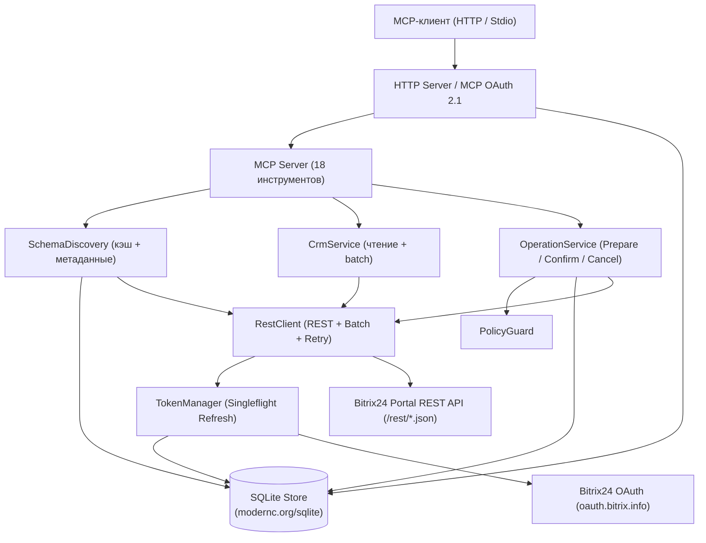

# Архитектура и внутреннее устройство

**Битрикс 24 MCP** спроектирован как монолитный бинарный сервис без внешних инфраструктурных зависимостей: он не требует Redis или PostgreSQL и компилируется с `CGO_ENABLED=0`.

---

## 1. Структура пакетов проекта

```text
.
├── cmd/b24/main.go                      # Точка входа, инициализация сервисов и graceful shutdown
├── internal/
│   ├── config/
│   │   └── config.go                    # Загрузка .env/ОС, валидация, JSON-логгер с редакцией секретов, AppError
│   ├── server/
│   │   └── server.go                    # HTTP-сервер, роутинг, OAuth consent UI, CSRF, WindowRateLimiter
│   ├── mcp/
│   │   ├── server.go                    # Регистрация 18 MCP-инструментов и изоляция по connectionId
│   │   └── oauth.go                     # MCP OAuth 2.1 + S256 PKCE, DCR, выдача/ротация/отзыв токенов
│   ├── bitrix/
│   │   ├── bitrix.go                    # OAuth 2.0 клиент Битрикс24, валидация доменов, TokenManager
│   │   ├── rest_client.go               # Вызов REST API и batch-запросов, ретраи с backoff, CollectPages
│   │   ├── schema_discovery.go          # Обнаружение сущностей, полей, воронок, стадий и кэширование
│   │   ├── crm.go                       # Поиск элементов, пакетное чтение карточек и товарных позиций
│   │   ├── operation.go                 # Двухэтапные операции записи (Prepare / Confirm / Cancel)
│   │   ├── policy.go                    # PolicyGuard (проверка режимов read_only / write_with_confirmation)
│   │   └── flex.go                      # Универсальные JSON-десериализаторы для нестрогих типов Битрикс24
│   └── store/
│       ├── store.go                     # Слой хранения SQLite, AES-256-GCM шифр, репозитории
│       └── migrations/
│           └── 001_initial_sqlite.sql   # Встроенная (`go:embed`) схема базы данных (goose)
└── scripts/
    ├── install-hooks.sh                 # Установка git pre-push хука
    └── pre-push.sh                      # Проверка go vet, go test и go build перед пушем в main
```

---

## 2. Поток обработки запросов



---

## 3. Движок REST и Batch-запросов (`internal/bitrix/rest_client.go`)

### Одиночные вызовы (`RestClient.Call`)
Каждый вызов метода Битрикс24 отправляется как `POST <client_endpoint>/<method>.json` с JSON-телом, куда автоматически добавляется актуальный токен `"auth": "<access_token>"`.

#### Обработка сбоев и ретраи:
1. **Протухший токен (`expired_token`, `INVALID_TOKEN`, `invalid_token`)**: если портал вернул ошибку токена, `RestClient` единожды запрашивает у `TokenManager` принудительное обновление токена (`forceRefresh = true`) и немедленно повторяет запрос.
2. **Лимиты и временные ошибки**: при сетевых ошибках, HTTP-кодах `429` или `5xx`, а также ошибках Битрикс24 `QUERY_LIMIT_EXCEEDED`, `OPERATION_TIME_LIMIT`, `TOO_MANY_REQUESTS` выполняется повтор (до `BITRIX_MAX_RETRIES`, по умолчанию 3 раза).
3. **Алгоритм ожидания (`sleepBackoff`)**:
   - Если в ответе присутствует заголовок `Retry-After` (в секундах), сервер ждёт указанное время (но не более 10 секунд).
   - Иначе используется экспоненциальная задержка с джиттером: $\min(250 \cdot 2^{\text{attempt}} + \text{rand}(0..200), 5000)$ мс.

### Пакетные вызовы (`RestClient.CallBatch`)
Битрикс24 поддерживает выполнение до **50 команд** (`BitrixBatchLimit = 50`) за один HTTP-запрос к методу `batch.json`.
- `BuildBatchCommand` сериализует вложенные карты и массивы параметров в URL-query строку формата `crm.item.list?entityTypeId=2&filter[%3DstageId]=NEW&select[0]=id`.
- Если передано больше 50 команд (например, при запросе товарных позиций для 200 сделок), `CallBatch` автоматически разбивает список на чанки по 50 команд и склеивает результаты в единую карту.
- Для обхода особенности PHP-сериализатора Битрикс24 (который возвращает пустой JSON-массив `[]` вместо пустого объекта `{}` в полях `result`, `result_error`, `result_total`, `result_next`) используется обобщённый тип `FlexMap[T]` из [`internal/bitrix/flex.go`](../internal/bitrix/flex.go).

### Умная пагинация (`RestClient.CollectPages`)
Списочные методы Битрикс24 возвращают максимум 50 элементов на страницу, а также поля `total` и `next`. Метод `CollectPages` оптимизирует выгрузку:
1. Запрашивает первую страницу (`start = 0`).
2. Если `next != nil` и нужно больше данных (в пределах `limit` и `BITRIX_MAX_PAGES`):
   - **Быстрый путь (через `batch`)**: если известен `total`, сервер заранее формирует команды для всех оставшихся смещений (`start = 50, 100, 150...`) и скачивает их пачками по 50 страниц за один HTTP-запрос.
   - **Последовательный фоллбэк**: если `total` не возвращён, сервер последовательно шагает по `next` до достижения `limit` или `BITRIX_MAX_PAGES`.

---

## 4. Гибкая десериализация (`internal/bitrix/flex.go`)

REST API Битрикс24 нередко возвращает одни и те же поля в разных типах данных (например, `ID` или `expires_in` могут прийти как число `3600` или строка `"3600"`, а `scope` — как строка `"crm,user"` или массив `["crm", "user"]`). Для защиты от ошибок парсинга используются специальные типы:
- `FlexString` — читает JSON-строки и числа как `string`.
- `FlexInt` — читает JSON-числа и строковые числа как `int`.
- `FlexScope` — читает строку или массив строк в единую строку через запятую.
- `FlexMap[V]` — читает JSON-объект `{...}` в `map[string]V`, а пустой массив `[]` или `null` безопасно превращает в пустую карту.

---

## 5. Архитектура хранилища SQLite (`internal/store/`)

Сервер использует чистый Go-драйвер `modernc.org/sqlite` с `MaxOpenConns(1)` и следующими настройками:
- `PRAGMA journal_mode = WAL;` — режим Write-Ahead Logging для высокой производительности и надёжности.
- `PRAGMA foreign_keys = ON;` — строгий контроль внешних ключей и каскадного удаления (`ON DELETE CASCADE`).
- `PRAGMA busy_timeout = 5000;` — ожидание до 5 секунд при блокировках записи.

### Таблицы базы данных (`001_initial_sqlite.sql`)

| Таблица | Назначение |
| --- | --- |
| `schema_migrations` / `goose_db_version` | Учёт применённых миграций схемы БД. |
| `bitrix_connections` | Подключённые порталы Битрикс24, зашифрованные `access_token_encrypted` и `refresh_token_encrypted`, режим (`read_only` / `write_with_confirmation`) и статус (`active`, `disabled`, `revoked`). Уникальный индекс по `(member_id, bitrix_user_id)`. |
| `oauth_states` | Одноразовые состояния (`state_hash`) для защиты OAuth 2.0 редиректа в Битрикс24 от CSRF и привязки к запросу MCP OAuth (`mcp_request_hash`). |
| `schema_cache` | Кэш метаданных портала по составному ключу `(connection_id, cache_key)`: `entity-types`, `fields:<typeId>`, `categories:<typeId>`, `stages:<typeId>:<catId>`. |
| `pending_operations` | Очередь двухшаговых операций записи (`create_item`, `update_item`, `move_item_stage`) с параметрами, человекочитаемым описанием, временем истечения и результатом. |
| `audit_logs` | Журнал аудита всех действий с операциями записи (`prepared`, `completed`, `failed`, `cancelled`). |
| `mcp_oauth_clients` | Зарегистрированные через Dynamic Client Registration (`/register`) клиенты MCP OAuth 2.1. |
| `mcp_oauth_authorization_requests` | Незавершённые запросы авторизации на экране согласия `/authorize` (хранят `code_challenge`, `redirect_uri`, `state` и счётчик попыток `attempts <= 5`). |
| `mcp_oauth_authorization_codes` | Одноразовые коды авторизации (`code_hash`), выпущенные после успешного входа в Битрикс24 и привязанные к `connection_id`. |
| `mcp_oauth_tokens` | Выданные клиентам MCP пары токенов (хранятся только SHA-256 хэши `access_token_hash` и `refresh_token_hash`), привязанные к `client_id` и `connection_id`. |
