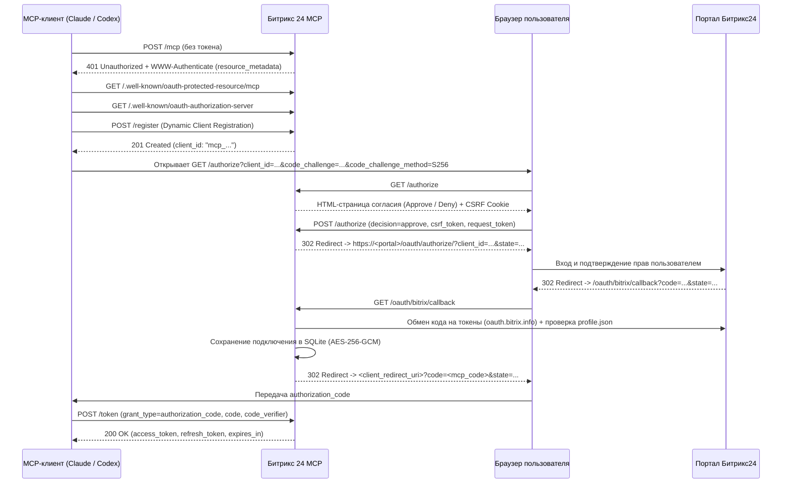

# Аутентификация, OAuth 2.1 и управление подключениями

**Битрикс 24 MCP** объединяет два контура авторизации:
1. **Входящий контур (MCP Client → MCP Server)**: аутентификация AI-клиентов по стандарту **MCP OAuth 2.1 с PKCE** либо по статическому **Bearer-токену (`MCP_AUTH_TOKEN`)**.
2. **Исходящий контур (MCP Server → Bitrix24)**: авторизация в портале Битрикс24 по **OAuth 2.0**, шифрование токенов в базе и их автоматическое обновление.

---

## 1. Аутентификация MCP-клиентов

Любой запрос к `POST /mcp` проверяется методом `OAuthService.VerifyAuthorizationHeader` по заголовку `Authorization: Bearer <token>`.

### Способ А: MCP OAuth 2.1 + S256 PKCE (рекомендуемый для пользовательских клиентов)

Сервер реализует спецификации **OAuth 2.1**, **RFC 8414** (Authorization Server Metadata), **RFC 9728** (Protected Resource Metadata) и **RFC 7591** (Dynamic Client Registration):



#### Ключевые особенности реализации OAuth 2.1:
- **Только публичные PKCE-клиенты**: `token_endpoint_auth_method` поддерживает только `"none"`, а при авторизации обязателен `code_challenge_method=S256` (длина `code_verifier` от 43 до 128 символов).
- **Безопасные Redirect URI**: при регистрации клиента (`/register`) разрешаются только `https://` URI или локальные HTTP loopback-адреса (`http://localhost`, `http://127.0.0.1`, `http://[::1]`) без `#fragment` и учётных данных.
- **Пропуск экрана согласия при наличии `MCP_AUTH_TOKEN`**: если запрос `GET /authorize` уже содержит валидный заголовок `Authorization: Bearer <MCP_AUTH_TOKEN>`, экран согласия пропускается и сразу выполняется редирект в Битрикс24.
- **Ротация Refresh-токенов**: при вызове `POST /token` с `grant_type=refresh_token` старый токен атомарно отзывается (`revoked_at`) и выпускается новая пара `access_token` + `refresh_token`. Повторное использование старого refresh-токена отклоняется с ошибкой `invalid_grant`.
- **Жёсткая изоляция подключения (`ConnectionID`)**: каждый токен, выданный через OAuth 2.1, привязывается к конкретному `connection.id` в таблице `mcp_oauth_tokens`.

---

### Способ Б: Статический токен (`MCP_AUTH_TOKEN`)

Для серверных сценариев, локальной отладки или работы с несколькими порталами одновременно можно передавать заголовок:

```http
Authorization: Bearer <MCP_AUTH_TOKEN>
```

Отличия статического токена от OAuth 2.1 токена:

| Возможность | Токен OAuth 2.1 | Статический `MCP_AUTH_TOKEN` |
| --- | --- | --- |
| Доступ к `bitrix_list_connections` | Возвращает только своё привязанное подключение | Возвращает **все** подключения в БД |
| Параметр `connectionId` в MCP-инструментах | Подставляется автоматически (попытка передать чужой `connectionId` вернёт `403 CONNECTION_ACCESS_DENIED`) | Требуется указывать явно `connectionId` нужного портала |
| Запуск `GET /oauth/bitrix/start` | Запрещено (`403 CONNECTION_ACCESS_DENIED`) | Разрешено (для подключения новых порталов) |
| Срок действия | Ограничен (`MCP_OAUTH_ACCESS_TOKEN_TTL_SECONDS`, по умолчанию 1 ч) | Бессрочный (до смены в `.env`) |

---

## 2. Подключение и верификация портала Битрикс24

Сервер поддерживает два пути получения токенов от Битрикс24:

### 1. Стандартный OAuth Authorization Code Flow (`/oauth/bitrix/callback`)
1. Создаётся одноразовая запись в `oauth_states` (в БД хранится только SHA-256 хэш от случайного 32-байтного `state`).
2. При возврате пользователя на `/oauth/bitrix/callback` состояние атомарно потребляется (`ConsumeOAuthState`).
3. Сервер обменивает `code` на `access_token` и `refresh_token` через `https://oauth.bitrix.info/oauth/token/`.
4. Проверяется совпадение `domain` и `member_id`, а также валидируется `client_endpoint` (обязан быть `https://<domain>/rest/`).
5. Выполняется контрольный запрос `POST <client_endpoint>/profile.json`, чтобы убедиться, что токен действителен и `USER_ID` совпадает с владельцем токена.

### 2. Установка локального приложения (`POST /oauth/bitrix/install`)
Когда администратор портала устанавливает приложение внутри интерфейса Битрикс24, портал присылает `POST`-запрос (в формате `application/x-www-form-urlencoded` с полями `auth[access_token]`, `AUTH_ID` и т.д. или JSON).
1. Сервер нормализует полезную нагрузку (`normalizeInstallationPayload`), извлекая домен из тела запроса, query-параметров или заголовков `Origin` / `Referer`.
2. Если `BITRIX_PORTAL_DOMAIN` не задан, установка разрешается только для уже зарегистрированных активных доменов (защита от перезаписи сторонним порталом).
3. Выполняется запрос `POST <client_endpoint>/app.info.json` — поле `result.CODE` обязано совпадать с `BITRIX_CLIENT_ID` (если `BITRIX_CLIENT_ID` не начинается с префикса `pending-`).
4. Выполняется запрос `POST <client_endpoint>/profile.json` для верификации `bitrix_user_id`.
5. Если клиент прислал заголовок `Accept: text/html`, сервер возвращает HTML-страницу со скриптом `BX24.init(function(){BX24.installFinish();})`, корректно завершая установку в интерфейсе Битрикс24.

---

## 3. Уникальность и жизненный цикл подключений

В таблице `bitrix_connections` действует уникальный индекс по паре `(member_id, bitrix_user_id)`:
- Если один и тот же пользователь портала повторно проходит авторизацию, существующая запись подключения **обновляется** (`UpsertConnection`) с сохранением прежнего `id`.
- Разные пользователи одного портала или разные порталы получают собственные независимые `connection.id`.

### Статусы подключения (`status`)
- `active` — подключение активно и готово к выполнению запросов.
- `revoked` — Битрикс24 отклонил `refresh_token` с кодом `invalid_grant`, `invalid_token` или `expired_token`. Сервер автоматически переводит подключение в статус `revoked`, после чего требуется повторная авторизация.
- `disabled` — подключение отключено.

---

## 4. Автоматическое обновление токенов (`TokenManager`)

Токены доступа Битрикс24 живут по умолчанию 1 час (`3600` секунд). За их свежесть отвечает `bitrix.TokenManager`:

1. **Упреждающее обновление**: если до истечения `ExpiresAt` осталось **менее 60 секунд**, `TokenManager.Get` автоматически запрашивает новый токен через `oauth.bitrix.info` с `grant_type=refresh_token`.
2. **Дедупликация параллельных обновлений (Inflight Singleflight)**: если одновременно выполняется 10 запросов к одному `connectionId` с истёкшим токеном, только одна горутина отправит запрос на обновление в Битрикс24, а остальные 9 дождутся результата по каналу `inflightRefresh.done`.
3. **Защита от отменённого контекста**: запрос на обновление токена выполняется через `context.WithoutCancel(ctx)`, чтобы отмена одного клиентского HTTP-запроса не прервала сохранение новой пары токенов в SQLite.
4. **Реактивное обновление при `expired_token`**: если Битрикс24 сбросил токен раньше времени и вернул ошибку `expired_token` или `INVALID_TOKEN` во время вызова REST API, `RestClient` автоматически запрашивает у `TokenManager` принудительное обновление (`forceRefresh = true`), передавая `staleAccessToken`, и прозрачно повторяет запрос.
5. **Ручное обновление**: вы также можете принудительно обновить токен через HTTP-эндпоинт `POST /oauth/bitrix/refresh` с телом `{"connection_id": "<uuid>"}`.
