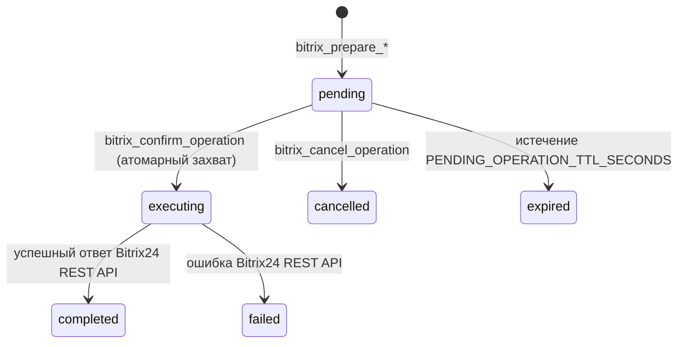

# Справочник MCP-инструментов (Tools Reference)

**Битрикс 24 MCP** предоставляет AI-агентам **18 инструментов**, разделённых на 4 логические категории:
1. [Подключения и обнаружение портала](#1-подключения-и-обнаружение-портала) (`bitrix_list_connections`, `bitrix_discover_portal`, `bitrix_list_crm_entities`, `bitrix_describe_entity`)
2. [Поля, воронки, стадии и кэш схемы](#2-поля-воронки-стадии-и-кэш-схемы) (`bitrix_list_fields`, `bitrix_list_categories`, `bitrix_list_stages`, `bitrix_refresh_schema_cache`)
3. [Чтение данных CRM и пакетные запросы](#3-чтение-данных-crm-и-пакетные-запросы) (`bitrix_search_items`, `bitrix_get_item`, `bitrix_list_product_rows`, `bitrix_list_users`)
4. [Двухшаговые операции записи](#4-двухшаговые-операции-записи) (`bitrix_prepare_create_item`, `bitrix_prepare_update_item`, `bitrix_prepare_move_item_stage`, `bitrix_confirm_operation`, `bitrix_cancel_operation`, `bitrix_list_pending_operations`)

---

## Стандартные коды `entityTypeId` в Битрикс24

В универсальных методах `crm.item.*` и во всех инструментах сервера используются следующие числовые идентификаторы сущностей:

| `entityTypeId` | Сущность | Код `ownerType` (для товарных позиций) | Тип |
| :---: | --- | :---: | --- |
| `1` | Лид (`Lead`) | `L` | Встроенная |
| `2` | Сделка (`Deal`) | `D` | Встроенная |
| `3` | Контакт (`Contact`) | `C` | Встроенная |
| `4` | Компания (`Company`) | `CO` | Встроенная |
| `7` | Предложение (`Quote`) | `Q` | Встроенная |
| `31` | Счёт (`Smart Invoice`) | `SI` | Встроенная |
| `128+` / `1030+` | Смарт-процесс (`SPA`) | `T<hex>` (например, `T80` для `128`) | Динамическая (`isDynamic: true`) |

---

## 1. Подключения и обнаружение портала

### `bitrix_list_connections`
Возвращает список подключённых порталов Битрикс24 без раскрытия `access_token`, `refresh_token` и секретов приложения.
- **Аннотации**: `readOnlyHint: true`, `destructiveHint: false`
- **Параметры**: нет.
- **Примечание**: если клиент авторизован через MCP OAuth 2.1, возвращается только одно привязанное к этому токену подключение. При использовании `MCP_AUTH_TOKEN` возвращаются все подключения в БД.
- **Пример ответа**:
  ```json
  [
    {
      "id": "550e8400-e29b-41d4-a716-446655440000",
      "domain": "company.bitrix24.ru",
      "memberId": "a1b2c3d4e5f6",
      "bitrixUserId": "1",
      "scope": "crm,user",
      "expiresAt": "2026-11-08T04:00:00.000Z",
      "mode": "write_with_confirmation",
      "adminToolsEnabled": false,
      "status": "active",
      "createdAt": "2026-11-08T03:00:00.000Z",
      "updatedAt": "2026-11-08T03:00:00.000Z"
    }
  ]
  ```

---

### `bitrix_discover_portal`
Возвращает публичную информацию о подключении вместе со списком всех доступных типов сущностей CRM (как встроенных, так и смарт-процессов).
- **Аннотации**: `readOnlyHint: true`, `destructiveHint: false`
- **Метод Битрикс24**: `crm.type.list` (с авто-пагинацией и кэшированием по ключу `entity-types`).
- **Параметры**:
  | Имя | Тип | Обязателен | По умолчанию | Описание |
  | --- | --- | :---: | --- | --- |
  | `connectionId` | `string` | Да* | — | UUID подключения из `bitrix_list_connections` (*для OAuth 2.1 токенов подставляется автоматически). |
  | `refresh` | `boolean` | Нет | `false` | Принудительно игнорировать кэш схемы и загрузить свежие данные из Битрикс24. |

---

### `bitrix_list_crm_entities`
Возвращает массив всех типов сущностей CRM (Лид, Сделка, Контакт, Компания, Счёт + все смарт-процессы из `crm.type.list`).
- **Аннотации**: `readOnlyHint: true`, `destructiveHint: false`
- **Параметры**:
  | Имя | Тип | Обязателен | По умолчанию | Описание |
  | --- | --- | :---: | --- | --- |
  | `connectionId` | `string` | Да | — | UUID подключения. |
  | `refresh` | `boolean` | Нет | `false` | Принудительное обновление кэша. |

---

### `bitrix_describe_entity`
Комплексное описание конкретной сущности CRM за один вызов: её метаданные, все поля (`fields`), воронки (`categories`) и стадии (`stages`) по каждой воронке.
- **Аннотации**: `readOnlyHint: true`, `destructiveHint: false`
- **Методы Битрикс24**: `crm.type.list`, `crm.item.fields`, `crm.category.list`, `crm.status.list` (если у сущности несколько воронок и стадии не в кэше, они выгружаются за один `batch`-запрос).
- **Параметры**:
  | Имя | Тип | Обязателен | По умолчанию | Описание |
  | --- | --- | :---: | --- | --- |
  | `connectionId` | `string` | Да | — | UUID подключения. |
  | `entityTypeId` | `integer` | Условно | — | Числовой ID типа сущности (`1`, `2`, `3`, `4`, `31` или ID смарт-процесса). Обязателен, если не указан `entityName`. |
  | `entityName` | `string` | Условно | — | Точное название сущности (регистронезависимо, с нормализацией диакритики Unicode NFD/NFC). Используется, если не передан `entityTypeId`. При неоднозначности вернёт `400 AMBIGUOUS_ENTITY`. |
  | `categoryId` | `integer` | Нет | все воронки | ID конкретной воронки/направления, если нужны стадии только одной воронки. |
  | `refresh` | `boolean` | Нет | `false` | Принудительно обновить кэш схемы. |

---

## 2. Поля, воронки, стадии и кэш схемы

### `bitrix_list_fields`
Возвращает описание всех стандартных и пользовательских (`ufCrm...`) полей сущности CRM или смарт-процесса.
- **Аннотации**: `readOnlyHint: true`, `destructiveHint: false`
- **Метод Битрикс24**: `crm.item.fields` (кэшируется по ключу `fields:<entityTypeId>`).
- **Параметры**:
  | Имя | Тип | Обязателен | По умолчанию | Описание |
  | --- | --- | :---: | --- | --- |
  | `connectionId` | `string` | Да | — | UUID подключения. |
  | `entityTypeId` | `integer` | Да | — | Числовой ID типа сущности. |
  | `refresh` | `boolean` | Нет | `false` | Принудительно обновить кэш. |

---

### `bitrix_list_categories`
Возвращает список воронок (направлений / категорий) для сделок или смарт-процессов.
- **Аннотации**: `readOnlyHint: true`, `destructiveHint: false`
- **Метод Битрикс24**: `crm.category.list` (кэшируется по ключу `categories:<entityTypeId>`).
- **Параметры**:
  | Имя | Тип | Обязателен | По умолчанию | Описание |
  | --- | --- | :---: | --- | --- |
  | `connectionId` | `string` | Да | — | UUID подключения. |
  | `entityTypeId` | `integer` | Да | — | Числовой ID типа сущности. |
  | `refresh` | `boolean` | Нет | `false` | Принудительно обновить кэш. |

---

### `bitrix_list_stages`
Возвращает отсортированный по `SORT ASC` список стадий для сущности и выбранной воронки.
- **Аннотации**: `readOnlyHint: true`, `destructiveHint: false`
- **Метод Битрикс24**: `crm.status.list` с автоматическим вычислением `ENTITY_ID`:
  - для Лидов (`entityTypeId = 1`): `STATUS`
  - для Сделок в общей воронке (`entityTypeId = 2, categoryId = 0`): `DEAL_STAGE`
  - для Сделок в доп. воронке (`entityTypeId = 2, categoryId > 0`): `DEAL_STAGE_<categoryId>`
  - для Смарт-процессов и прочих сущностей: `DYNAMIC_<entityTypeId>_STAGE_<categoryId>`
- **Параметры**:
  | Имя | Тип | Обязателен | По умолчанию | Описание |
  | --- | --- | :---: | --- | --- |
  | `connectionId` | `string` | Да | — | UUID подключения. |
  | `entityTypeId` | `integer` | Да | — | Числовой ID типа сущности. |
  | `categoryId` | `integer` | Нет | `0` | ID воронки/категории. |
  | `refresh` | `boolean` | Нет | `false` | Принудительно обновить кэш. |

---

### `bitrix_refresh_schema_cache`
Полностью очищает кэш схемы (`schema_cache`) в SQLite для указанного подключения.
- **Аннотации**: `readOnlyHint: true`, `destructiveHint: false`
- **Параметры**:
  | Имя | Тип | Обязателен | Описание |
  | --- | --- | :---: | --- |
  | `connectionId` | `string` | Да | UUID подключения. |
- **Ответ**: `{"clearedEntries": 5}`

---

## 3. Чтение данных CRM и пакетные запросы

### `bitrix_search_items`
Универсальный поиск элементов CRM (лидов, сделок, контактов, компаний, счетов, элементов смарт-процессов) с поддержкой фильтров Битрикс24, автоматической пакетной пагинацией и опциональной подгрузкой товарных позиций за один вызов.
- **Аннотации**: `readOnlyHint: true`, `destructiveHint: false`
- **Методы Битрикс24**: `crm.item.list` (с авто-догрузкой страниц через `batch`) + опционально `batch` из `crm.item.productrow.list`.
- **Параметры**:
  | Имя | Тип | Обязателен | По умолчанию | Описание |
  | --- | --- | :---: | --- | --- |
  | `connectionId` | `string` | Да | — | UUID подключения. |
  | `entityTypeId` | `integer` | Да | — | Числовой ID типа сущности (`1` — лид, `2` — сделка, `3` — контакт, `4` — компания, `31` — счёт или ID SPA). |
  | `filter` | `object` | Нет | `{}` | Объект фильтра Битрикс24 (например, `{"=stageId": "NEW", ">=opportunity": 50000}`). |
  | `select` | `string[]` | Нет | `["*"]` | Массив возвращаемых полей (например, `["id", "title", "stageId", "opportunity", "ufCrm_123"]`). |
  | `order` | `object` | Нет | `{"id": "ASC"}` | Сортировка (например, `{"id": "DESC"}`). |
  | `limit` | `integer` | Нет | `100` | Максимальное число элементов для возврата (ограничено также `BITRIX_MAX_PAGES * 50`). |
  | `includeProductRows` | `boolean` | Нет | `false` | Если `true`, сервер автоматически выполнит пакетный `batch`-запрос `crm.item.productrow.list` для всех найденных элементов и встроит массив `productRows` в каждый элемент ответа. |

- **Пример ответа**:
  ```json
  {
    "items": [
      {
        "id": 42,
        "title": "Поставка оборудования",
        "stageId": "C1:NEW",
        "opportunity": 150000,
        "productRows": [
          {
            "id": 101,
            "ownerId": 42,
            "ownerType": "D",
            "productName": "Серверная стойка",
            "price": 150000,
            "quantity": 1
          }
        ]
      }
    ],
    "total": 1,
    "truncated": false
  }
  ```

---

### `bitrix_get_item`
Получение одного элемента CRM по `id` или сразу множества элементов за один `batch`-запрос по массиву `ids`.
- **Аннотации**: `readOnlyHint: true`, `destructiveHint: false`
- **Методы Битрикс24**: `crm.item.get` (одиночный вызов или пакетный `batch` по чанкам до 50 команд).
- **Параметры**:
  | Имя | Тип | Обязателен | Описание |
  | --- | --- | :---: | --- |
  | `connectionId` | `string` | Да | UUID подключения. |
  | `entityTypeId` | `integer` | Да | Числовой ID типа сущности. |
  | `id` | `integer` | Условно | ID одного элемента CRM (если не передан `ids`). |
  | `ids` | `integer[]` | Условно | Массив ID элементов CRM для пакетного получения за один вызов (приоритетнее `id`; дубликаты автоматически удаляются). |

> Когда передан массив `ids`, ответ представляет собой словарь `{ "<id>": { ...данные элемента... } }`.

---

### `bitrix_list_product_rows`
Пакетная выгрузка товарных позиций (строк товаров) для одной или сразу множества сделок / элементов CRM через `batch` + `crm.item.productrow.list`. Позволяет получить товары для десятков или сотен сделок за один вызов без циклов на стороне LLM.
- **Аннотации**: `readOnlyHint: true`, `destructiveHint: false`
- **Метод Битрикс24**: `crm.item.productrow.list` внутри `batch`.
- **Параметры**:
  | Имя | Тип | Обязателен | По умолчанию | Описание |
  | --- | --- | :---: | --- | --- |
  | `connectionId` | `string` | Да | — | UUID подключения. |
  | `dealIds` | `integer[]` | Условно | — | Массив ID сделок для пакетной выгрузки (предпочтительный параметр при проверке нескольких сделок). |
  | `ownerIds` | `integer[]` | Условно | — | Массив ID элементов CRM (алиас для `dealIds`, если `dealIds` не передан). |
  | `dealId` | `integer` | Условно | — | ID одной сделки. |
  | `ownerId` | `integer` | Условно | — | ID одного элемента CRM (алиас для `dealId`). |
  | `entityTypeId` | `integer` | Нет | `2` (Сделка) | Числовой ID типа сущности, из которого автоматически вычисляется `ownerType` (`1→L`, `2→D`, `3→C`, `4→CO`, `7→Q`, `31→SI`, иначе `T<hex>`). |
  | `ownerType` | `string` | Нет | авто | Явный краткий код типа владельца (`D`, `L`, `Q`, `SI`, `T80` и т.д.). |
  | `filter` | `object` | Нет | `{}` | Дополнительный фильтр для товарных позиций. |
  | `order` | `object` | Нет | `{"sort": "asc"}` | Сортировка товарных позиций. |
  | `limit` | `integer` | Нет | `100` | Лимит строк товаров (применяется при запросе по одному `dealId`/`ownerId`). |

- **Формат ответа при пакетном запросе (`dealIds` / `ownerIds`)**:
  ```json
  {
    "productRows": [ ...все товары плоским списком... ],
    "byOwnerId": {
      "10": [ ...товары сделки 10... ],
      "20": [ ...товары сделки 20... ]
    },
    "ownersCount": 2
  }
  ```

---

### `bitrix_list_users`
Возвращает список пользователей портала Битрикс24, видимых авторизованному пользователю.
- **Аннотации**: `readOnlyHint: true`, `destructiveHint: false`
- **Метод Битрикс24**: `user.get` (с автоматической пакетной пагинацией всех страниц).
- **Параметры**:
  | Имя | Тип | Обязателен | По умолчанию | Описание |
  | --- | --- | :---: | --- | --- |
  | `connectionId` | `string` | Да | — | UUID подключения. |
  | `filter` | `object` | Нет | `{}` | Фильтр для `user.get` (например, `{"ACTIVE": true, "UF_DEPARTMENT": 5}`). |

---

## 4. Двухшаговые операции записи

Все изменения данных в Битрикс24 проходят через двухфазный протокол безопасности:
1. Подключение обязано находиться в режиме `write_with_confirmation` (если режим `read_only`, любая попытка подготовки вернёт `403 POLICY_DENIED`).
2. Инструменты `bitrix_prepare_*` **не отправляют** запрос в Битрикс24. Они сохраняют параметры вызова в таблицу `pending_operations` со сроком жизни `PENDING_OPERATION_TTL_SECONDS` (по умолчанию 10 минут), записывают событие `prepared` в `audit_logs` и возвращают `operation_id`.
3. Только после вызова `bitrix_confirm_operation` с полученным `operationId` сервер атомарно переводит операцию в статус `executing`, вызывает метод Битрикс24 и фиксирует результат (`completed` или `failed`) в `pending_operations` и `audit_logs`.



---

### `bitrix_prepare_create_item`
Подготавливает операцию создания нового элемента CRM или смарт-процесса (`crm.item.add`).
- **Аннотации**: `readOnlyHint: false`, `destructiveHint: false`
- **Параметры**:
  | Имя | Тип | Обязателен | Описание |
  | --- | --- | :---: | --- |
  | `connectionId` | `string` | Да | UUID подключения (в режиме `write_with_confirmation`). |
  | `entityTypeId` | `integer` | Да | Числовой ID типа сущности. |
  | `fields` | `object` | Да | Непустой объект значений полей создаваемого элемента (например, `{"title": "Новая сделка", "opportunity": 50000}`). |
- **Пример ответа**:
  ```json
  {
    "requires_confirmation": true,
    "operation_id": "9b1deb4d-3b7d-4bad-9bdd-2b0d7b3dcb6d",
    "summary": "Create an item in CRM entity type 2.",
    "expires_at": "2026-11-08T03:20:00Z"
  }
  ```

---

### `bitrix_prepare_update_item`
Подготавливает операцию обновления полей существующего элемента CRM или смарт-процесса (`crm.item.update`).
- **Аннотации**: `readOnlyHint: false`, `destructiveHint: false`
- **Параметры**:
  | Имя | Тип | Обязателен | Описание |
  | --- | --- | :---: | --- |
  | `connectionId` | `string` | Да | UUID подключения. |
  | `entityTypeId` | `integer` | Да | Числовой ID типа сущности. |
  | `id` | `integer` | Да | ID обновляемого элемента CRM. |
  | `fields` | `object` | Да | Непустой объект изменяемых полей. |

---

### `bitrix_prepare_move_item_stage`
Подготавливает операцию перевода элемента CRM или смарт-процесса на другую стадию (`crm.item.update` с `fields: {"stageId": "<stageId>"}`).
- **Аннотации**: `readOnlyHint: false`, `destructiveHint: false`
- **Параметры**:
  | Имя | Тип | Обязателен | Описание |
  | --- | --- | :---: | --- |
  | `connectionId` | `string` | Да | UUID подключения. |
  | `entityTypeId` | `integer` | Да | Числовой ID типа сущности. |
  | `id` | `integer` | Да | ID элемента CRM. |
  | `stageId` | `string` | Да | Идентификатор целевой стадии (например, `WON`, `C1:PREPARATION`, `DT128_1:SUCCESS`). |

---

### `bitrix_confirm_operation`
Явно подтверждает и выполняет одну подготовленную операцию записи в Битрикс24.
- **Аннотации**: `readOnlyHint: false`, `destructiveHint: true`
- **Параметры**:
  | Имя | Тип | Обязателен | Описание |
  | --- | --- | :---: | --- |
  | `operationId` | `string` | Да | UUID подготовленной операции из ответа `bitrix_prepare_*`. |
- **Пример ответа**:
  ```json
  {
    "operationId": "9b1deb4d-3b7d-4bad-9bdd-2b0d7b3dcb6d",
    "status": "completed",
    "summary": "Create an item in CRM entity type 2.",
    "result": {
      "item": {
        "id": 105,
        "title": "Новая сделка"
      }
    }
  }
  ```

---

### `bitrix_cancel_operation`
Отменяет подготовленную операцию со статусом `pending` без обращения к Битрикс24 и записывает событие `cancelled` в `audit_logs`.
- **Аннотации**: `readOnlyHint: false`, `destructiveHint: false`
- **Параметры**:
  | Имя | Тип | Обязателен | Описание |
  | --- | --- | :---: | --- |
  | `operationId` | `string` | Да | UUID подготовленной операции. |

---

### `bitrix_list_pending_operations`
Возвращает список последних подготовленных операций (до 100 записей, отсортированных по дате создания `DESC`), автоматически помечая просроченные операции статусом `expired`.
- **Аннотации**: `readOnlyHint: true`, `destructiveHint: false`
- **Параметры**:
  | Имя | Тип | Обязателен | Описание |
  | --- | --- | :---: | --- |
  | `connectionId` | `string` | Нет | Опциональный фильтр по UUID подключения (для OAuth 2.1 токенов всегда изолирован своим подключением). |

---

## Формат ошибок инструментов

Если при вызове любого инструмента возникает ошибка валидации, политики доступа или REST API Битрикс24, сервер возвращает стандартный MCP `CallToolResult` с флагом `IsError: true` и JSON-телом:

```json
{
  "error": "POLICY_DENIED",
  "message": "This connection is read-only; write operations cannot be prepared"
}
```
